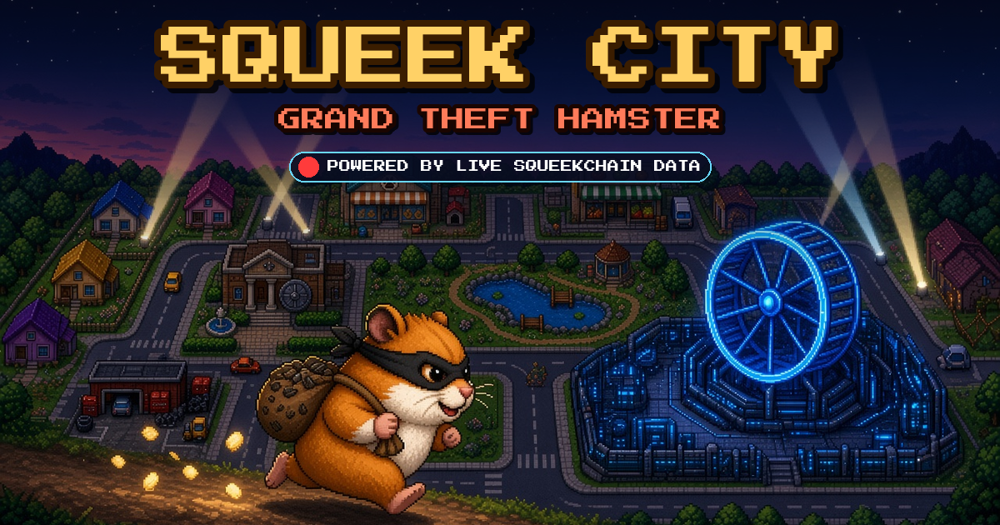
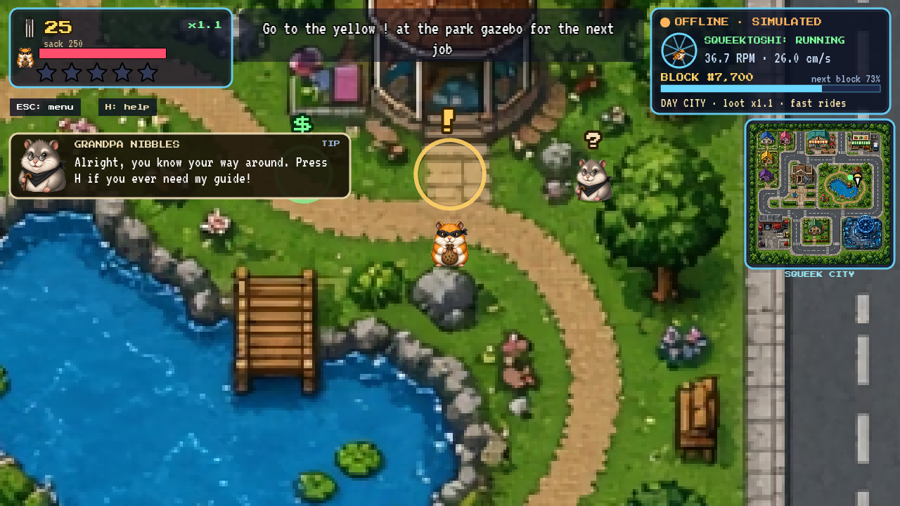
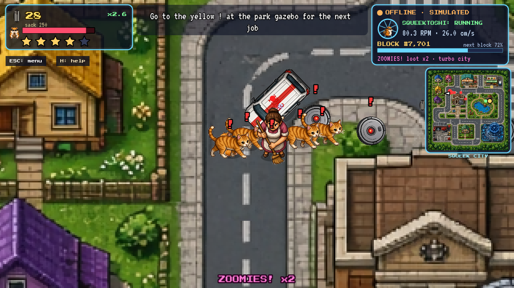
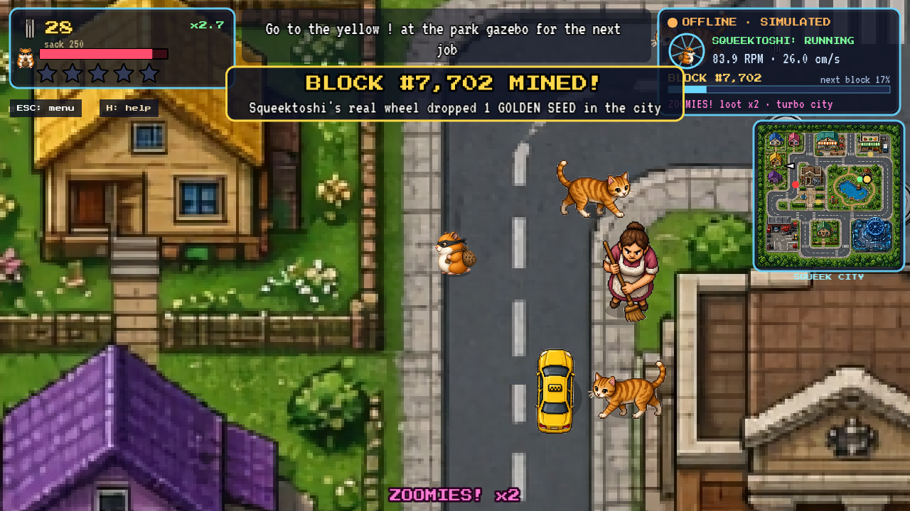
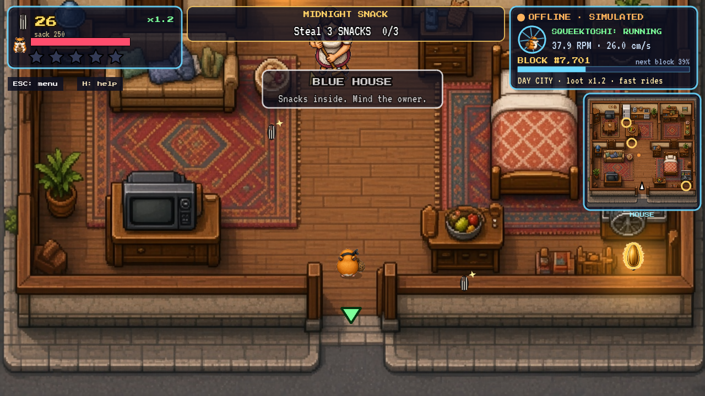
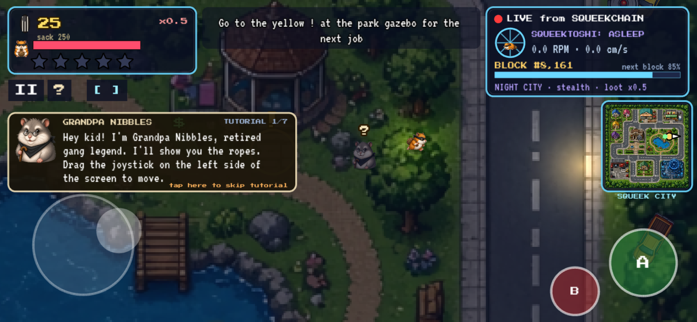

<p align="center"><a href="https://squeekcity.space"></a></p>

<p align="center">
  <a href="https://squeekcity.space"></a>
  
  <a href="https://api.squeekchain.com/v1/status"></a>
  <a href="LICENSE"></a>
</p>

<h3 align="center"><a href="https://squeekcity.space">Play now at squeekcity.space</a></h3>

A top-down pixel-art heist game in the browser. You play a hamster thief working through a small town's houses, shops and streets. The town's day and night cycle is driven by a real hamster: Squeektoshi, whose wheel mines blocks on [Squeekchain](https://squeekchain.com).

## How Squeekchain drives the city

Every 5 seconds the game polls `https://api.squeekchain.com/v1/status` and reads the wheel's status, RPM and the current block height (`js/state.js`).

| Chain state | What happens in game |
|---|---|
| Squeektoshi running | Day city: more patrols, faster rides, loot bonus that scales with RPM |
| Squeektoshi asleep | Night city: darker streets, guards see less, loot pays x0.5 |
| 70+ RPM | ZOOMIES: double loot, faster vehicles, faster music |
| New block mined | Golden seeds (25 each) drop around town and show up as gold dots on the minimap |

If the API can't be reached, the HUD says `OFFLINE · SIMULATED` and the game runs on a local simulation until the API responds again.

## Screenshots

| | |
|---|---|
|  |  |
|  |  |

<p align="center"></p>

## Features

| | |
|---|---|
| Story | 13 missions from the park hideout, ending with the Genesis Heist at the Squeekchain Lab |
| Side jobs | Seed Courier and Vacuum Bash |
| Wanted level | 1-5 stars: alley cats, robot vacuums, angry owners with brooms, the pest control van, the Cat Patrol car. Hide in hedges to cool down faster |
| Vehicles | RC racer, toy cars stolen off the road, skateboard, hamster ball |
| Interiors | Walk into houses and shops and steal from them while the owners are around |
| Shop | Speed, bigger sack, dash, armor and five hamster skins |
| Help | Grandpa Nibbles walks you through a tutorial, and pressing H opens his guide |
| Saves | Progress is stored in your browser's local storage |

## Controls

| Action | Keyboard | Mobile |
|---|---|---|
| Move | WASD / arrow keys | Left joystick |
| Interact, ride, steal, talk | E / Enter | A |
| Dash (once bought), drift while driving | Shift / Space | B |
| Big map | M | Map button |
| Help | H | ? |
| Pause | P / Esc | II |
| Skip tutorial | T | Tap the tutorial box |

Landscape works best on phones. In portrait the game shows a rotate prompt, or you can choose to play in portrait anyway.

## Run locally

It's a static site with no build step. Phaser is vendored in `lib/`.

```sh
git clone https://github.com/jexeth738/hamster-city.git
cd hamster-city
python3 -m http.server 8000
# open http://localhost:8000
```

## Hosting

Hosted on GitHub Pages from `main` with the custom domain in `CNAME`.

## Credits

Built by 0xyas & Jex. Fonts: Press Start 2P and VT323 (SIL OFL).

## License

[MIT](LICENSE)
